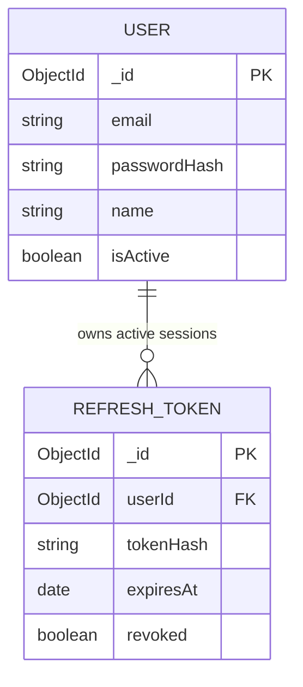
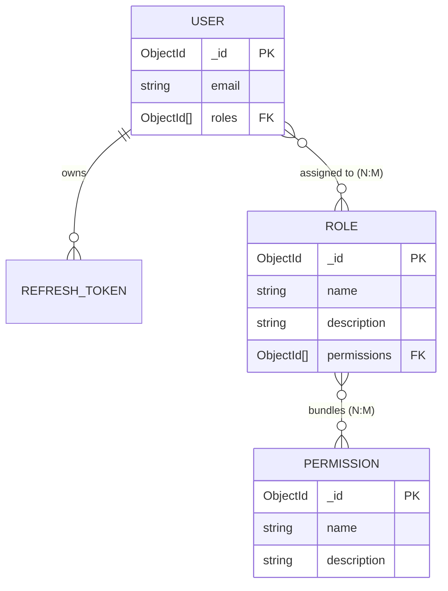
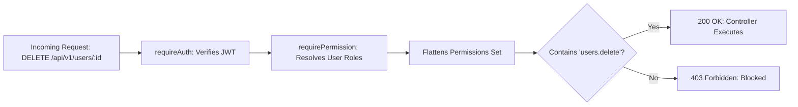
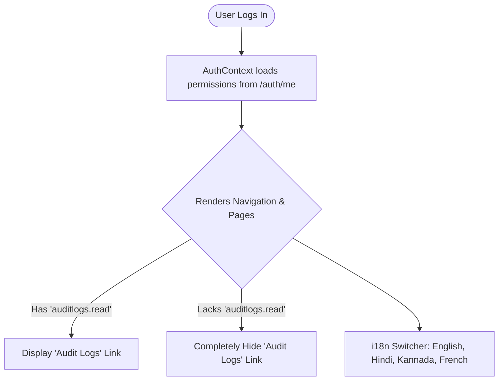
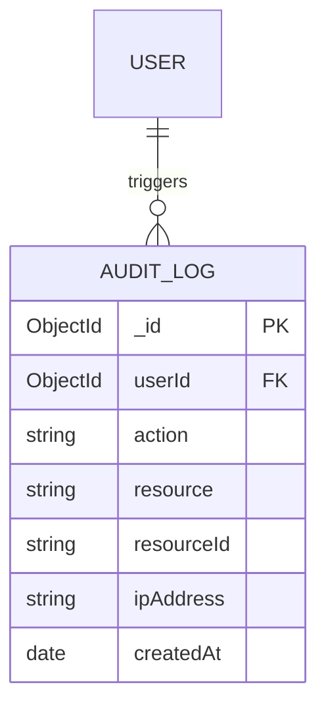
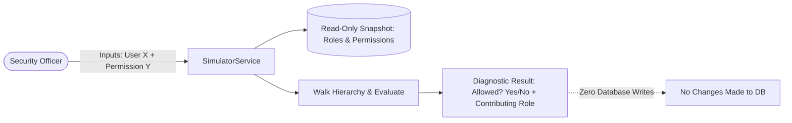
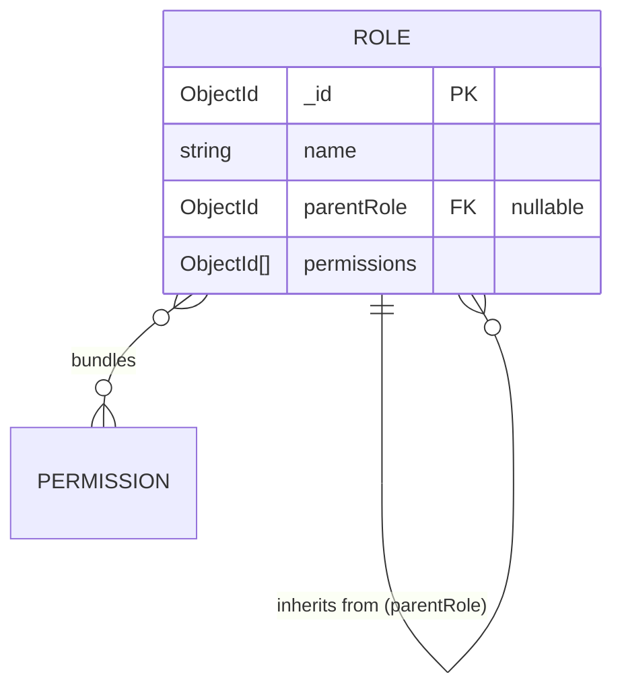
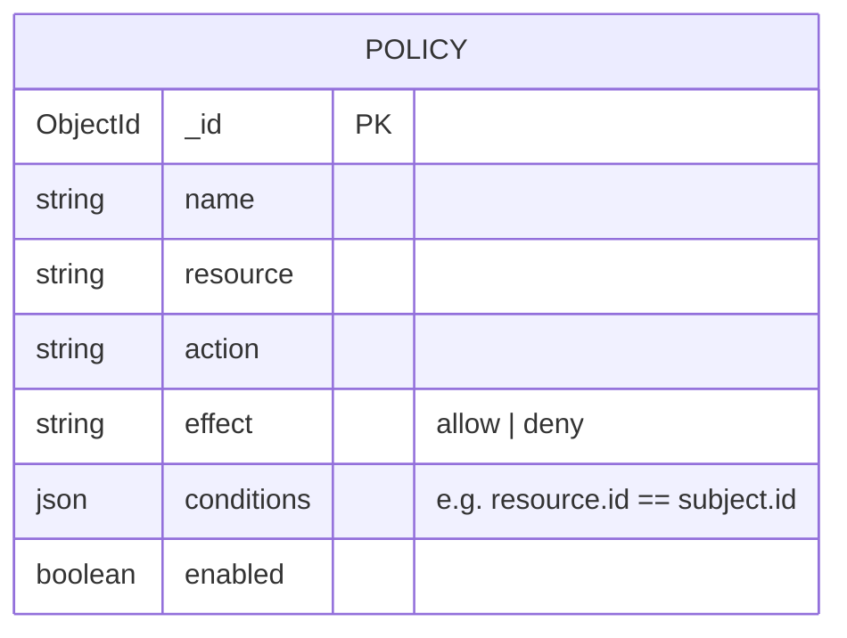
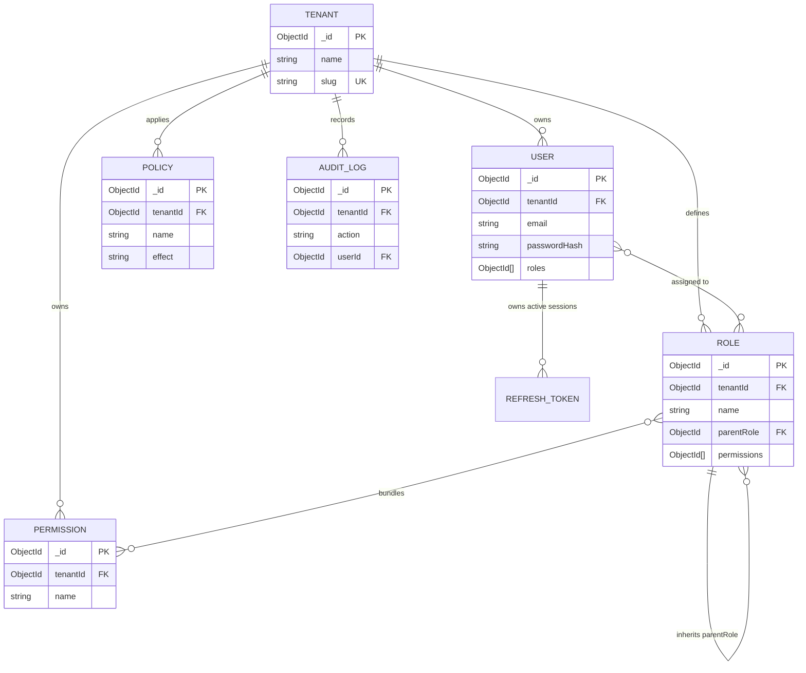

# AccessFlow: Step-by-Step Architecture, ER Diagrams & Real-World Use Cases

This guide walks through each phase of the project's evolution. For every step, you will see:
1. **The ER Diagram** showing how the data model expands at that step.
2. **The Real-World Use Case** in simple, plain language explaining why enterprises require that step.

---

## Step 1: Authentication & Secure Tokenization (Phase 1)

### ER Diagram

### Real-World Use Case
- **The Scenario:** An employee logs into their company portal from their work laptop and their mobile phone.
- **Why this step matters:**
  - Standard apps keep users logged in by storing vulnerable tokens in `localStorage`. If an employee visits a malicious website or falls victim to XSS, attackers can steal that token.
  - In Step 1, AccessFlow stores short-lived (15 min) JWTs in memory and long-lived refresh tokens in secure, browser-restricted `httpOnly` cookies.
  - If a hacker copies an old refresh token, AccessFlow detects **token reuse**, immediately locks down the user's account, and terminates all active sessions across both phone and laptop.

---

## Step 2: Role-Based Access Control (RBAC) (Phase 2)

### ER Diagram

### Real-World Use Case
- **The Scenario:** A hospital onboarding 500 nurses, 80 doctors, and 20 lab technicians.
- **Why this step matters:**
  - Manually assigning 40 specific system permissions to 600 individual staff members would require 24,000 manual assignments—creating administrative chaos and human error.
  - With RBAC, administrators bundle permissions into a single role (e.g., `Nurse` role = 15 permissions). When a new nurse is hired, the admin simply assigns the `Nurse` role in one click.

---

## Step 3: Atomic Permission Authorization Engine (Phase 3)

### Architectural Flow Diagram

### Real-World Use Case
- **The Scenario:** Modifying company permissions without breaking software code.
- **Why this step matters:**
  - Weak systems write hardcoded code like: `if (user.role === 'Admin')`. If the company creates a new role called `Super_Manager`, developers have to rewrite and re-deploy backend code.
  - Step 3 introduces **Atomic Permissions** (`users.delete`, `roles.create`). Code checks *what action is being performed*, never the role name. Roles can be created, renamed, or deleted anytime without modifying a single line of backend code.

---

## Step 4: Protected Multi-Language UI (Phase 4)

### Component Gating Diagram

### Real-World Use Case
- **The Scenario:** A global company with offices in the US, France, and India, employing staff with varied clearances.
- **Why this step matters:**
  - Standard employees should not see confusing disabled buttons or "Access Denied" screens for features they aren't cleared to use.
  - Using `<PermissionGate>` and `<RequirePermission>`, the UI dynamically adapts to each user's clearance.
  - Multi-language support allows Indian branch workers to use Hindi or Kannada, and European offices to use French.

---

## Step 5: Immutable Audit Logging (Phase 5)

### ER Diagram

### Real-World Use Case
- **The Scenario:** A bank undergoing a financial security audit (SOC 2, ISO 27001).
- **Why this step matters:**
  - An auditor asks: *"Who changed Sarah's role from Support to Admin on Tuesday at 3:00 PM?"*
  - Without audit logs, databases only store the *current* state, leaving no proof of history.
  - Step 5 records an immutable, append-only log of every login, failed attempt, role grant, and permission change for compliance and forensic investigations.

---

## Step 6: Diagnostic Permission Simulator (Phase 6)

### Data Simulation Flow

### Real-World Use Case
- **The Scenario:** A security officer wants to verify access before assigning high-privilege roles.
- **Why this step matters:**
  - In complex organizations, assigning a role might inadvertently grant unintended access (e.g., granting access to billing data by mistake).
  - The Permission Simulator lets admins run "what-if" simulations to see exactly which permissions would be granted and which role grants them, without touching live database records.

---

## Step 7: Hierarchical Role Inheritance (Phase 7)

### ER Diagram

### Real-World Use Case
- **The Scenario:** Corporate promotions and org-chart management.
- **Why this step matters:**
  - A `Senior Engineer` gets promoted to `Engineering Manager`. The manager must retain all developer privileges plus gain manager privileges.
  - By setting `parentRole`, child roles inherit all parent and ancestor permissions automatically.
  - Built-in **Cycle Detection** ensures admins cannot accidentally create infinite loops (e.g., Role A inherits Role B which inherits Role A).

---

## Step 8: Attribute-Based Access Control (ABAC) (Phase 8)

### ER Diagram

### Real-World Use Case
- **The Scenario:** Self-service profile updates and explicit safety bans.
- **Why this step matters:**
  - Standard RBAC says: *"Users with `users.update` can edit users."* If you give this to an employee, they can edit *everyone's* profile.
  - ABAC allows fine-grained rules: *"An employee can update a user record ONLY IF `resource.id == subject.id` (their own account)."*
  - **Explicit Deny Precedence:** A policy `deny-self-delete` ensures that even if an admin has permission to delete users, they cannot accidentally delete their own account. Deny always wins.

---

## Step 9: Multi-Tenancy & Enterprise Isolation (Phase 9)

### Complete Master ER Diagram

### Real-World Use Case
- **The Scenario:** Selling software to competing companies (e.g., Nike and Adidas).
- **Why this step matters:**
  - Nike and Adidas both purchase subscriptions to the platform.
  - Multi-tenancy partitions the database completely using `tenantId` and compound indexes (`{ tenantId: 1, name: 1 }`).
  - Nike's admin can create custom roles, invite employees, and manage policies without any risk of data leaking to or colliding with Adidas.

---

## Summary Table

| Step / Phase | Primary Entity Added | Core Problem Solved | Real-World Analogue |
| :--- | :--- | :--- | :--- |
| **1. Auth & Session** | `User`, `RefreshToken` | XSS defense, token theft detection, instant session revocation | Banking login security |
| **2. RBAC Foundation** | `Role`, `Permission` | Eliminates manual per-user permission assignments | Hospital / School staff roles |
| **3. Authorization** | Middleware engine | Removes fragile hardcoded role checks from code | Enterprise API gateways |
| **4. Protected UI** | React Client, i18n | Adapts UI to user clearance; international workforce | Modern SaaS web applications |
| **5. Audit Logging** | `AuditLog` | Regulatory non-repudiation and forensic tracing | SOC 2 / HIPAA compliance |
| **6. Simulator** | Simulation engine | Zero-risk "what-if" access verification | Cloud IAM policy simulators |
| **7. Role Hierarchy** | `parentRole` on `Role` | Org-chart inheritance without permission duplication | Corporate promotion ladders |
| **8. ABAC** | `Policy` | Fine-grained ownership rules; explicit Deny safety rules | Self-service profile updates |
| **9. Multi-Tenancy** | `Tenant` | Complete company isolation under a single platform | Slack / AWS Organizations |
