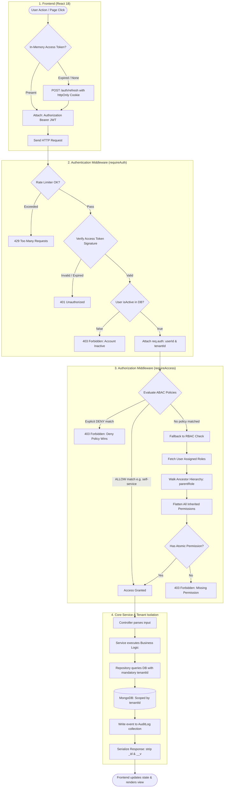
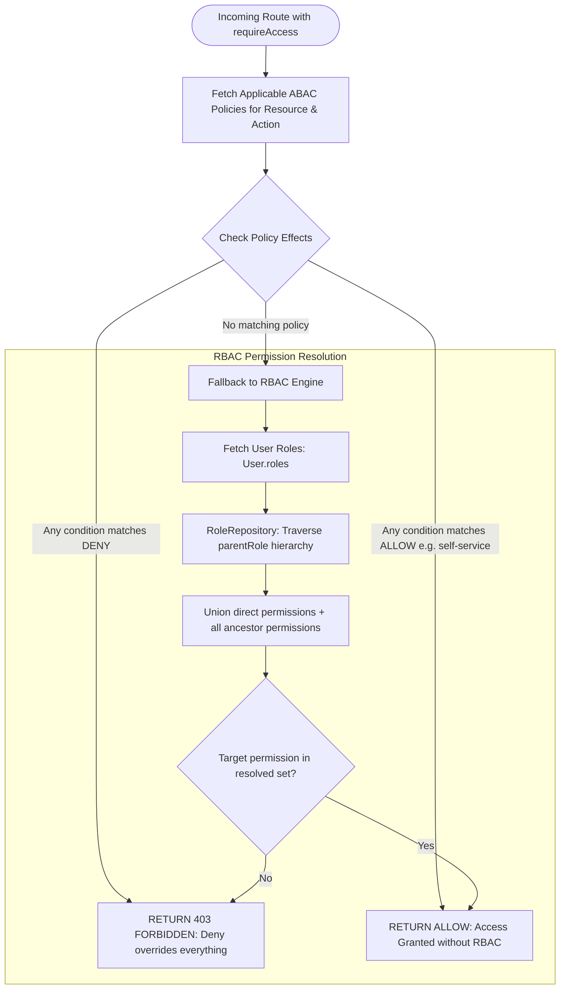
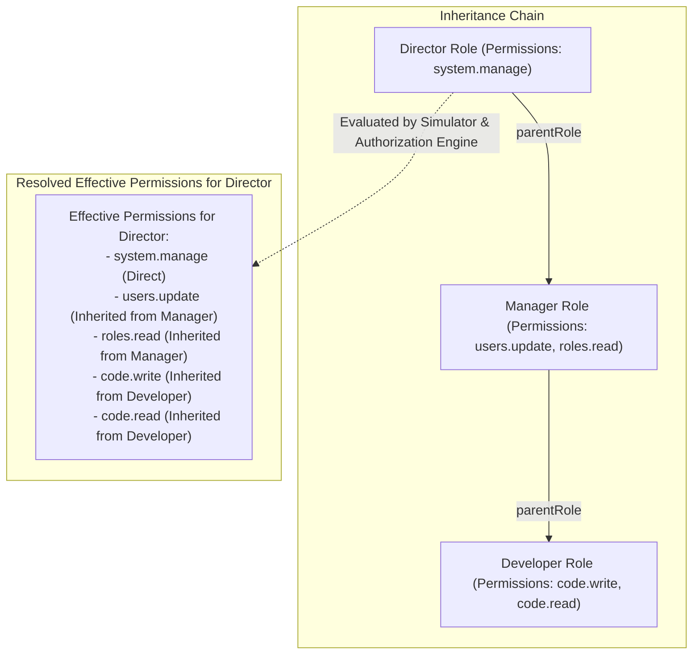
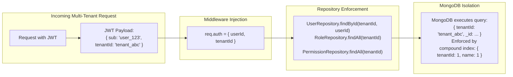

# AccessFlow: Complete Flow Diagrams

This document contains visual diagrams for every architectural flow in the system.

---

## 1. End-to-End Request & Security Lifecycle Flow

---

## 2. JWT Dual-Token Authentication & Silent Refresh Flow

```mermaid
sequenceDiagram
    autonumber
    actor User as User Browser
    participant React as React App (In-Memory)
    participant API as Express Backend
    participant DB as MongoDB

    Note over User,DB: Initial Login
    User->>React: Enters Email, Password & Tenant Slug
    React->>API: POST /api/v1/auth/login
    API->>DB: Verify credentials & tenant
    API->>API: Generate Access Token (JWT, 15m) & Refresh Token (JWT, 7d)
    API->>DB: Store SHA-256 hash of refresh token
    API-->>React: Body: { accessToken } + Cookie: refreshToken (httpOnly)
    React->>React: Store accessToken in JavaScript memory

    Note over User,DB: Normal Authorized API Call
    React->>API: GET /api/v1/users (Header: Bearer <accessToken>)
    API->>API: requireAuth verifies signature
    API-->>React: 200 OK with data

    Note over User,DB: Silent Token Refresh (After 15 minutes)
    React->>API: GET /api/v1/users (Expired Token)
    API-->>React: 401 Unauthorized
    React->>API: POST /api/v1/auth/refresh (Sends httpOnly cookie automatically)
    API->>DB: Verify refresh token hash & rotate token
    API-->>React: 200 OK: New Access Token + New httpOnly Cookie
    React->>API: Replays original GET /api/v1/users (Seamless retry)
    API-->>React: 200 OK with data
```

---

## 3. Two-Tier Authorization Engine Flow (ABAC + RBAC)

---

## 4. Role Hierarchy & Inheritance Flow

---

## 5. Multi-Tenant Scoping & Database Isolation Flow

